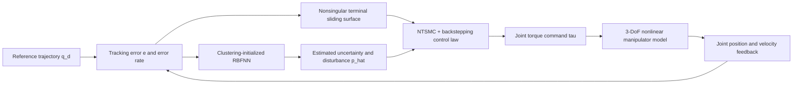

<a id="readme-top"></a>

<div align="center">

# 🤖 Robust Adaptive Control for a 3-DoF Industrial Manipulator

### High-precision MATLAB/Simulink trajectory control for an ABB IRB1600-based robot arm

A portfolio-ready implementation of **Nonsingular Terminal Sliding Mode Control**, **Backstepping**, and a **clustering-initialized RBF Neural Network** for accurate, robust, and low-chattering joint-space control.

<p>
  <a href="https://www.mathworks.com/products/matlab.html"></a>
  <a href="https://www.mathworks.com/products/simulink.html"></a>
  
  
</p>

<p>
  <a href="#-quick-start"><strong>Run the simulation »</strong></a>
  &nbsp;·&nbsp;
  <a href="#-performance-results"><strong>View results</strong></a>
  &nbsp;·&nbsp;
  <a href="#-control-architecture"><strong>Explore architecture</strong></a>
  &nbsp;·&nbsp;
  <a href="docs/paper/nguyen-et-al-2025-intelligent-robust-control-design-for-a-3-dof-industrial-manipulator.pdf"><strong>Read the paper</strong></a>
</p>

> **Repository description**  
> MATLAB/Simulink simulation of robust adaptive trajectory control for an ABB IRB1600-based 3-DoF manipulator using NTSMC, backstepping, and clustering-initialized RBFNN disturbance estimation.

</div>

---

<details open>
<summary><strong>📑 Table of contents</strong></summary>

- [Project snapshot](#-project-snapshot)
- [Why this project matters](#-why-this-project-matters)
- [Representative results](#-representative-results)
- [Control architecture](#-control-architecture)
- [System and controller design](#-system-and-controller-design)
- [Quick start](#-quick-start)
- [Run all experiments](#-run-all-experiments)
- [Performance results](#-performance-results)
- [Repository structure](#-repository-structure)
- [Engineering skills demonstrated](#-engineering-skills-demonstrated)
- [Scope and limitations](#-scope-and-limitations)
- [Roadmap](#-roadmap)
- [Publication and citation](#-publication-and-citation)
- [License](#-license)

</details>

## ⚡ Project snapshot

<table>
<tr>
<td width="25%" align="center"><strong>Industrial platform</strong><br><br>ABB IRB1600-inspired<br>3-DoF manipulator</td>
<td width="25%" align="center"><strong>Control stack</strong><br><br>NTSMC<br>Backstepping<br>RBFNN</td>
<td width="25%" align="center"><strong>Validation</strong><br><br>Sine and square references<br>Ideal and disturbed cases</td>
<td width="25%" align="center"><strong>Best reported RMSE</strong><br><br><code>0.000202</code><br>ideal sine tracking</td>
</tr>
</table>

| Engineering question | Repository answer |
|---|---|
| **What is controlled?** | Coupled joint motion of a nonlinear 3-DoF industrial manipulator model |
| **What is implemented?** | NTSMC + backstepping + adaptive RBFNN disturbance estimation |
| **What is compared?** | Proposed controller vs. Adaptive Fuzzy-SMC and SMC-NN baselines |
| **What is measured?** | Tracking RMSE, convergence time, control torque, disturbance rejection, and execution timing |
| **What is the project status?** | Research-grade MATLAB/Simulink simulation; hardware validation remains future work |

<p align="right"><a href="#readme-top">Back to top ↑</a></p>

## 🏭 Why this project matters

Industrial robot controllers must maintain precision despite nonlinear coupling, friction, uncertain payloads, model mismatch, external disturbances, and abrupt motion commands. Conventional sliding mode control is robust, but discontinuous switching can introduce chattering and undesirable actuator stress.

<table>
<tr>
<td width="33%" valign="top">
<h3 align="center">🎯 Precision</h3>
<p align="center">Accurate joint-space trajectory tracking under nominal and disturbed operating conditions.</p>
</td>
<td width="33%" valign="top">
<h3 align="center">🛡️ Robustness</h3>
<p align="center">Adaptive compensation for uncertainty, nonlinear dynamics, friction, and external disturbances.</p>
</td>
<td width="33%" valign="top">
<h3 align="center">⚙️ Actuator-aware control</h3>
<p align="center">Smooth switching and bounded torque behavior intended to reduce chattering and control spikes.</p>
</td>
</tr>
</table>

### Core design goals

- High-accuracy joint trajectory tracking
- Rapid convergence after startup and command changes
- Disturbance and model-uncertainty compensation
- Reduced chattering through smooth switching
- Control inputs constrained by modeled actuator saturation
- Compact neural adaptation suitable for high-frequency simulation

<p align="right"><a href="#readme-top">Back to top ↑</a></p>

## 📊 Representative results

> Add the generated images to the paths below to display the result gallery directly on the repository landing page.

| Control input | Angle tracking | Tracking error |
|:---:|:---:|:---:|
|  |  |  |
| **Torque response** | **Desired vs. actual trajectory** | **Joint tracking error** |

<details>
<summary><strong>🖼️ Suggested result gallery organization</strong></summary>

```text
figures/
├── control_input/
│   ├── Sine_Ideal_ControlInput1.jpg
│   ├── Sine_Disturbed_ControlInput1.png
│   ├── Square_Ideal_ControlInput1.png
│   └── Square_Disturbed_ControlInput1.jpg
├── angle_tracking/
│   └── Square_Disturbed_AngleTracking1.jpg
└── error_tracking/
    └── Square_Disturbed_ErrorLink1.jpg
```

Use consistent filenames for joints 1–3 so readers can compare the same experiment across all axes.

</details>

<p align="right"><a href="#readme-top">Back to top ↑</a></p>

## 🧭 Control architecture



| Module | Function | Industrial relevance |
|---|---|---|
| **Backstepping** | Builds the controller recursively across linked nonlinear error subsystems | Structured control of coupled manipulator dynamics |
| **NTSMC** | Forms a nonlinear sliding surface for robust, rapid tracking convergence | Strong rejection of matched uncertainty and disturbances |
| **Smooth switching** | Replaces `sign(s)` with `tanh(s)` | Reduces chattering and high-frequency torque oscillation |
| **RBFNN adaptation** | Estimates unmodeled dynamics and external disturbance online | Reduces dependence on a perfectly identified robot model |
| **Clustering initialization** | Organizes error data to initialize RBF centers and widths | Reduces manual neural-network parameter selection |

<p align="right"><a href="#readme-top">Back to top ↑</a></p>

## 🧠 System and controller design

<details open>
<summary><strong>1. Manipulator dynamics</strong></summary>

The simulated plant represents the first three joints of an **ABB IRB1600-inspired articulated manipulator**. The full six-axis platform is reduced to three degrees of freedom to focus on coupled nonlinear joint-position control.

```math
M(q)\ddot{q} + C(q,\dot{q})\dot{q} + g(q) + f(\dot{q}) = \tau + p(t)
```

| Symbol | Meaning |
|---|---|
| `q`, `q_dot`, `q_ddot` | Joint position, velocity, and acceleration |
| `M(q)` | Inertia matrix |
| `C(q, q_dot)` | Coriolis and centrifugal effects |
| `g(q)` | Gravity vector |
| `f(q_dot)` | Friction model |
| `tau` | Commanded joint torque |
| `p(t)` | External disturbance and model uncertainty |

### Nominal parameters

| Parameter | Value |
|---|---:|
| Joint masses | `10 kg`, `8 kg`, `5 kg` |
| Link lengths | `0.6 m`, `0.8 m`, `1.2 m` |
| NTSMC exponents | `gamma = 3`, `sigma = 2` |
| Sliding-surface gain | `lambda = 15` |
| Backstepping gain | `c1 = 0.01` |
| RBFNN learning rate | `eta = 0.01` |
| Switching gain | `K = 5` |

</details>

<details>
<summary><strong>2. Backstepping and NTSMC formulation</strong></summary>

Backstepping decomposes the manipulator into linked error subsystems. A virtual velocity command first stabilizes the position error, and the physical torque command then stabilizes the second subsystem.

The nonsingular terminal sliding surface combines position and velocity errors using a nonlinear exponent. The switching term is smoothed as:

```math
\tau_{sw} = -K\tanh(s)
```

The smooth hyperbolic-tangent term reduces the discontinuity associated with the classical `sign(s)` switching law.

</details>

<details>
<summary><strong>3. Adaptive RBF neural network</strong></summary>

- Architecture: **2-7-1 RBFNN**
- Inputs: joint tracking error and error derivative
- Hidden layer: seven radial-basis neurons
- Output: estimated uncertainty/disturbance contribution
- Adaptation: online weight update driven by the sliding-surface signal

```math
\hat{p} = \hat{W}^{T}H(X)
```

</details>

<details>
<summary><strong>4. Clustering-based initialization</strong></summary>

The clustering stage organizes the error-state data before online adaptation and supplies structured values for the RBFNN centers and widths.

| Item | Reported value |
|---|---:|
| Number of clusters / hidden neurons | `7` |
| Clustering iterations | `460` |
| Shared center | `c = 0.035` |
| Shared Gaussian width | `sigma = 0.412` |

> The paper and source-tree notes use related clustering terms, including SNNC and MNNC. This README uses the implementation-neutral phrase **clustering-based initialization** until the final MATLAB source is checked and documented consistently.

</details>

<p align="right"><a href="#readme-top">Back to top ↑</a></p>

## 🚀 Quick start

### Prerequisites

- MATLAB
- Simulink
- A MATLAB release capable of opening the included `.slx` and legacy `.mdl` models

> Exact MATLAB release and toolbox dependencies have not yet been pinned. MATLAB will report missing products when a model is opened.

### 1. Clone the repository

```bash
git clone https://github.com/<your-username>/<repository-name>.git
cd <repository-name>
```

### 2. Start the main proposed controller

```matlab
cd src/ntsmc_backstepping
run('Initialization.m')
open_system('NTSMC.slx')
sim('NTSMC.slx')
```

### 3. Generate the main metrics and plots

```matlab
run('NTSMCplot.m')
run('RMSECal.m')
run('ConTime.m')
```

> The sequence above is reconstructed from the documented folder tree and filename roles. Verify script dependencies, workspace variables, and model callbacks against the final source before claiming one-command reproducibility.

<p align="right"><a href="#readme-top">Back to top ↑</a></p>

## 🧪 Run all experiments

The evaluation uses three controllers across four operating scenarios.

### Controller comparison

| Controller | Role |
|---|---|
| **NTSMC + Backstepping + clustered RBFNN** | Proposed controller |
| **Adaptive Fuzzy-SMC** | Robust-control baseline |
| **SMC-RBFNN** | Neural adaptive-control baseline |

### Test matrix

| Reference | Environment | Engineering purpose |
|---|---|---|
| Sine wave | Ideal | Smooth periodic tracking |
| Sine wave | Disturbed | Robustness to friction and periodic disturbance |
| Square wave | Ideal | Response to abrupt command changes |
| Square wave | Disturbed | Combined abrupt transitions and uncertainty |

<details>
<summary><strong>▶ Proposed NTSMC + Backstepping controller</strong></summary>

```matlab
cd src/ntsmc_backstepping
run('Initialization.m')
open_system('NTSMC.slx')
sim('NTSMC.slx')
run('NTSMCplot.m')
run('RMSECal.m')
run('ConTime.m')
```

</details>

<details>
<summary><strong>▶ Clustering-enhanced variant</strong></summary>

```matlab
cd src/ntsmc_clustering
run('Initialization.m')
run('MNNC.m')
run('MNNCPlot.m')
open_system('NTSMCCluster.slx')
sim('NTSMCCluster.slx')
run('NTSMCplotCluster.m')
```

Use `MNNCPlotDynamically.m` when the script version supports animated cluster formation.

</details>

<details>
<summary><strong>▶ Adaptive Fuzzy-SMC baseline</strong></summary>

```matlab
cd src/baseline_fuzzy_smc
open_system('Fuz3dof_sim.mdl')
sim('Fuz3dof_sim.mdl')
run('Fuz3dof_plot.m')
```

</details>

<details>
<summary><strong>▶ SMC-RBFNN baseline</strong></summary>

```matlab
cd src/baseline_smc_rbfnn
open_system('RBFsim.mdl')
sim('RBFsim.mdl')
run('RBFplot.m')
```

</details>

<details>
<summary><strong>▶ Cross-controller comparison</strong></summary>

After each model has generated its workspace data or saved outputs:

```matlab
cd src/ntsmc_clustering
run('Plotcombine.m')
```

Several folders contain helper scripts with repeated names. Work inside one controller folder at a time to avoid MATLAB path conflicts.

</details>

<p align="right"><a href="#readme-top">Back to top ↑</a></p>

## 🏆 Performance results

### Headline metrics

<table>
<tr>
<td width="25%" align="center"><strong>Ideal RMSE</strong><br><br><code>0.000202</code></td>
<td width="25%" align="center"><strong>Disturbed RMSE</strong><br><br><code>0.002634</code></td>
<td width="25%" align="center"><strong>Ideal convergence</strong><br><br><code>0.037533 s</code></td>
<td width="25%" align="center"><strong>Disturbed convergence</strong><br><br><code>0.280800 s</code></td>
</tr>
</table>

### Average sine-wave tracking RMSE

| Condition | Proposed | Fuzzy-SMC | SMC-NN |
|---|---:|---:|---:|
| Ideal | **0.000202** | 0.000477 | 0.015168 |
| Disturbed | **0.002634** | 0.011748 | 0.225156 |

### Average convergence time

| Condition | Proposed | Fuzzy-SMC | SMC-NN |
|---|---:|---:|---:|
| Ideal | **0.037533 s** | 0.388067 s | 1.576533 s |
| Disturbed | **0.280800 s** | 1.146867 s | 2.488133 s |

### Relative improvement of the proposed controller

| Comparison | Ideal condition | Disturbed condition |
|---|---:|---:|
| RMSE vs. Fuzzy-SMC | **≈57.7% lower** | **≈77.6% lower** |
| RMSE vs. SMC-NN | **≈98.7% lower** | **≈98.8% lower** |
| Convergence time vs. Fuzzy-SMC | **≈90.3% shorter** | **≈75.5% shorter** |
| Convergence time vs. SMC-NN | **≈97.6% shorter** | **≈88.7% shorter** |

<details>
<summary><strong>⚙️ Control-effort and computation observations</strong></summary>

### Control effort

- Reported startup torque is below approximately `50 Nm` for the main evaluated joint.
- The SMC-NN baseline requires approximately `130 Nm` at startup in the same comparison.
- Under square-wave transitions, comparison controllers exhibit spikes approaching `220 Nm`.
- Joint-torque saturation is modeled at approximately `250 Nm`.

### Computation

| Measurement | Reported value |
|---|---:|
| Simulink fixed-step sample time | `0.2 ms` |
| Average adaptive-module update time | `≈0.085 ms` per step |
| Offline clustering initialization | `10.2 s` |
| Reference processor | Intel Core i7-9750H |

These timings support feasibility inside the tested simulation configuration. They do not establish deterministic real-time performance on an industrial robot controller.

</details>

<p align="right"><a href="#readme-top">Back to top ↑</a></p>

## 🗂️ Repository structure

```text
.
├── src/
│   ├── ntsmc_backstepping/       # Main proposed controller
│   ├── ntsmc_clustering/         # RBFNN clustering and clustered variant
│   ├── baseline_fuzzy_smc/       # Adaptive fuzzy-SMC baseline
│   └── baseline_smc_rbfnn/       # SMC-RBFNN baseline
├── figures/
│   ├── control_input/            # Joint-torque plots
│   ├── angle_tracking/           # Desired-versus-actual trajectories
│   └── error_tracking/           # Joint tracking-error plots
├── parameters/                   # Robot and controller parameters
├── docs/
│   └── paper/                    # Publication and supporting documentation
├── README.md
├── .gitignore
└── LICENSE
```

<details>
<summary><strong>🔎 File naming guide</strong></summary>

| Filename pattern | Role |
|---|---|
| `*ctrl.m` | Controller and adaptive-law implementation |
| `*plant.m` | Nonlinear manipulator dynamics |
| `*input*.m` | Reference trajectory and disturbance generation |
| `*.slx` / `*.mdl` | Top-level Simulink experiment model |
| `*plot*.m` | Result visualization |
| `RMSECal.m` | Tracking-error metric calculation |
| `ConTime.m` | Convergence-time calculation |
| `Plotcombine.m` | Cross-controller comparison |
| `MNNC.m` | Clustering computation |
| `MNNCPlot*.m` | Static or dynamic clustering visualization |
| `Initialization.m` | Parameters and workspace initialization |

> The `plant`, `ctrl`, and `input` files are normally called by the corresponding Simulink model. Run the top-level `.slx` or `.mdl` experiment rather than executing a plant function independently.

</details>

<p align="right"><a href="#readme-top">Back to top ↑</a></p>

## 🧰 Engineering skills demonstrated

<table>
<tr>
<td width="50%" valign="top">

- MATLAB and Simulink modeling
- Nonlinear manipulator dynamics
- Nonsingular terminal sliding mode control
- Backstepping controller design
- Lyapunov-based stability analysis
- Actuator saturation modeling

</td>
<td width="50%" valign="top">

- RBF neural-network approximation
- Data-driven controller initialization
- Online disturbance estimation
- Trajectory tracking and disturbance rejection
- Controller benchmarking
- Technical performance visualization

</td>
</tr>
</table>

### Technology and topic keywords

<p>
  
  
  
  
  
  
  
</p>

<p align="right"><a href="#readme-top">Back to top ↑</a></p>

## ⚠️ Scope and limitations

- This repository is a **simulation research prototype**, not a production robot controller.
- The model uses the first three joints of an ABB IRB1600-inspired system; it is not a full six-axis ABB controller.
- Reported performance is based on MATLAB/Simulink simulation, not physical robot experiments.
- The disturbance tests emphasize periodic noise and friction; impulse and broader non-periodic disturbances are not comprehensively validated.
- The controller assumes full-state feedback.
- Square-wave references are stress tests for abrupt transitions; production trajectories normally constrain velocity, acceleration, and jerk.
- Hardware deployment would require sensor processing, actuator interfaces, safety monitoring, collision handling, timing validation, torque-limit verification, and independent testing.
- The displayed Lyapunov derivation establishes non-increasing energy and asymptotic stability under its assumptions; the README therefore uses **rapid convergence** rather than independently asserting a complete finite-time proof.

<p align="right"><a href="#readme-top">Back to top ↑</a></p>

## 🛣️ Roadmap

- [x] Model a coupled 3-DoF industrial manipulator
- [x] Implement NTSMC and backstepping control
- [x] Add adaptive RBFNN uncertainty estimation
- [x] Compare against Fuzzy-SMC and SMC-NN baselines
- [x] Evaluate ideal and disturbed trajectories
- [ ] Pin the exact MATLAB release and required toolboxes
- [ ] Consolidate all initialization scripts into one reproducible entry point
- [ ] Export all metrics automatically to `.csv` or `.mat`
- [ ] Add automated regression tests for RMSE and torque limits
- [ ] Add hardware-in-the-loop validation
- [ ] Validate on a physical manipulator or real-time target

<p align="right"><a href="#readme-top">Back to top ↑</a></p>

## 📄 Publication and citation

This repository accompanies:

> L. Nguyen, K. Pham, and T. Tran, **“Intelligent robust control design for a 3-DoF industrial manipulator,”** *Transactions of the Institute of Measurement and Control*, 2025.  
> DOI: [10.1177/01423312251366726](https://doi.org/10.1177/01423312251366726)

<p>
  <a href="https://doi.org/10.1177/01423312251366726"></a>
</p>

<details>
<summary><strong>📚 Copy BibTeX citation</strong></summary>

```bibtex
@article{nguyen2025intelligent,
  title   = {Intelligent robust control design for a 3-DoF industrial manipulator},
  author  = {Nguyen, Loc and Pham, Khoi and Tran, Thanh},
  journal = {Transactions of the Institute of Measurement and Control},
  year    = {2025},
  doi     = {10.1177/01423312251366726}
}
```

</details>

<p align="right"><a href="#readme-top">Back to top ↑</a></p>

## 📜 License

Source code is distributed under the license provided in [`LICENSE`](LICENSE). The publisher-formatted paper and publication figures remain subject to their original copyright and reuse terms and are not automatically covered by the source-code license.

---

<div align="center">

**Industrial robotics · Robust control · Adaptive estimation · MATLAB/Simulink**

Made for transparent engineering review, reproducible simulation, and robotics job applications.

<a href="#readme-top"><strong>Back to top ↑</strong></a>

</div>
